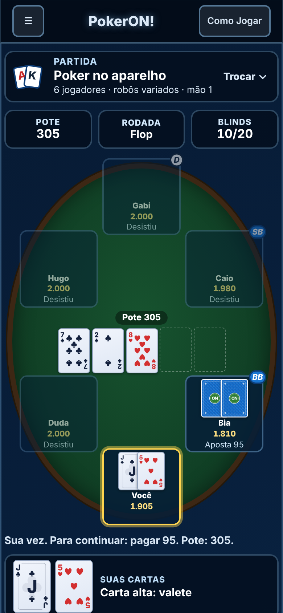
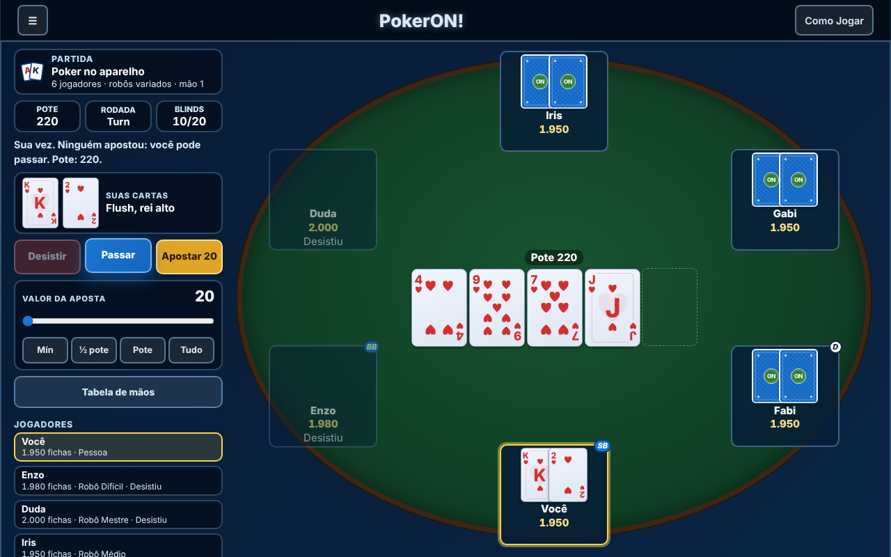

# PokerON!

Texas Hold'em sem limite de aposta, de 2 a 9 jogadores, em dois modos: **Poker no aparelho**, com as cartas na tela, contra robôs ou passando o aparelho entre amigos, e **Mesa com cartas reais**, em que o app faz o papel de dealer e de banco enquanto vocês jogam com baralho e fichas de verdade. A tabela de mãos fica a um toque durante toda a partida. Funciona no navegador ou instalado como app, inclusive sem internet.

**Jogue:** https://onpoker.netlify.app/ · **Mais jogos:** https://speccygames.netlify.app/

  
  &nbsp;&nbsp;
  

## Como jogar

1. Toque no botão da partida, no alto da tela, e escolha o modo.
2. No **Poker no aparelho**, defina quantos jogadores são (de 2 a 9), quantos são **pessoas**, o **nível** dos robôs, as **fichas** de cada um e se os blinds **sobem** com o tempo. Depois toque em **Jogar**.
3. Cada jogador recebe duas cartas viradas para baixo. Em cada rodada você **passa**, **paga**, **aumenta** ou **desiste**, e as cartas da mesa vão se abrindo: flop, turn e river.
4. No fim, vence o pote quem tiver a melhor mão de cinco cartas, ou quem sobrar quando todos os outros desistirem.
5. A partida termina quando um jogador fica com todas as fichas.

O botão **Como Jogar** do topo explica o site, as regras, o dealer e os blinds, as rodadas e traz dicas de estratégia. Na primeira visita ele abre sozinho.

## Poker no aparelho

É uma partida honesta: o aparelho embaralha, distribui, abre as cartas da mesa e diz quem ganhou, sem voltar atrás. Dá para jogar sozinho contra robôs, passar o aparelho entre amigos ou misturar pessoas e robôs na mesma mesa. Quando o aparelho vai de mão em mão, uma tela de passagem esconde as suas cartas entre uma vez e outra.

## Mesa com cartas reais

Para quem joga com baralho e fichas na mesa. O app controla o dealer, os blinds, de quem é a vez, as apostas, os potes (inclusive os laterais) e as fichas de cada um, e nenhuma carta aparece na tela. Em volta da mesa, vocês dizem ao app o que cada um fez e, no fim, quem ganhou cada pote.

- **Retroceder ação** desfaz a última jogada, quantas vezes for preciso
- **Jogadores e fichas** corrige nomes e fichas entre uma mão e outra, tira um jogador da mesa e chama um novo
- **Blinds** mudam a qualquer momento, com ante opcional
- Empates e potes divididos são resolvidos pelo app, e a ficha que sobra vai para quem está à esquerda do dealer

## Os robôs

Cinco níveis: o 1 Iniciante joga com cartas e apostas quase ao acaso, o 2 Fácil paga muito e aumenta pouco, o 3 Médio escolhe melhor as mãos de saída e pensa nas chances, o 4 Difícil faz isso com mais cuidado e respeita as apostas grandes, e o 5 Mestre também lê o jeito de jogar de cada adversário. Dá para misturar níveis na mesma mesa com a opção **Variados**. Os robôs só usam o que um jogador de verdade sabe: nunca olham as cartas de ninguém.

## Tabela de mãos

As dez combinações, da mais forte à mais fraca, ficam no botão **Tabela de mãos** (ou na tecla **T** no computador), em qualquer um dos modos. Cada linha mostra um exemplo com as cartas desenhadas e a chance de a combinação aparecer em sete cartas. A mesma tabela está no Como Jogar.

| # | Mão | Exemplo |
|---|---|---|
| 1 | Royal flush | A, K, Q, J e 10 do mesmo naipe |
| 2 | Straight flush | Cinco cartas em sequência, do mesmo naipe |
| 3 | Quadra | Quatro cartas do mesmo valor |
| 4 | Full house | Uma trinca e um par |
| 5 | Flush | Cinco cartas do mesmo naipe |
| 6 | Sequência | Cinco cartas em sequência |
| 7 | Trinca | Três cartas do mesmo valor |
| 8 | Dois pares | Dois pares de valores diferentes |
| 9 | Par | Duas cartas do mesmo valor |
| 10 | Carta alta | Nenhuma das anteriores |

## Recursos

- Mesa oval no aparelho, com dealer, blinds e a vez de cada um marcados. No computador e com o celular deitado, os controles ficam numa coluna e a mesa fica sempre à vista
- Aposta com controle deslizante e atalhos **Mín**, **½ pote**, **Pote** e **Tudo**
- Todas as regras do poker de verdade: aumento mínimo, all-in curto, potes laterais e devolução da aposta que ninguém pagou
- Sorteio das cartas feito com uma semente complexa e diferente a cada partida, em qualquer aparelho
- O painel **Suas cartas** mostra o nome da sua melhor mão em cada rodada (par, trinca, flush...)
- Velocidade dos robôs à sua escolha, e um botão para acelerar a vez deles
- Teclado: **F** desiste, **C** passa ou paga, **T** abre a tabela
- Partida salva automaticamente: feche a aba e continue depois
- Menu lateral com atalho **Outros Jogos**, **estatísticas** (partidas, vitórias, mãos ganhas, maior pote, robôs eliminados e melhor mão num showdown) e **configurações** (som, vibração, modo escuro, reduzir animações)
- Modo escuro e "reduzir animações" (seguem o sistema por padrão)
- Instala no celular ou no computador e funciona offline

O jogo não tem partida online pela internet: as pessoas precisam estar juntas, passando o aparelho ou usando a mesa com cartas reais.

## Instalando como app

- **Chrome e Edge (computador e Android):** botão **Instalar app** no menu ☰ ou o ícone na barra de endereço.
- **Safari (iPhone e iPad):** Compartilhar, depois *Adicionar à Tela de Início*.

## Créditos

Os números e os naipes das cartas usam contornos da fonte Inter ExtraBold (SIL Open Font License 1.1). Fonte: https://rsms.me/inter/.

Os ícones usam a fonte DejaVu Sans Bold, que parte da Bitstream Vera (© 2003 Bitstream, Inc., licença que permite uso gratuito, inclusive comercial; as mudanças do DejaVu são de domínio público). Fonte: https://dejavu-fonts.github.io/.

## Família ON!

PokerON! segue a base visual do **DiciON!**. Todos os jogos ficam em https://speccygames.netlify.app/.

---

Feito por Christian ([@Christian5910](https://github.com/Christian5910)).
